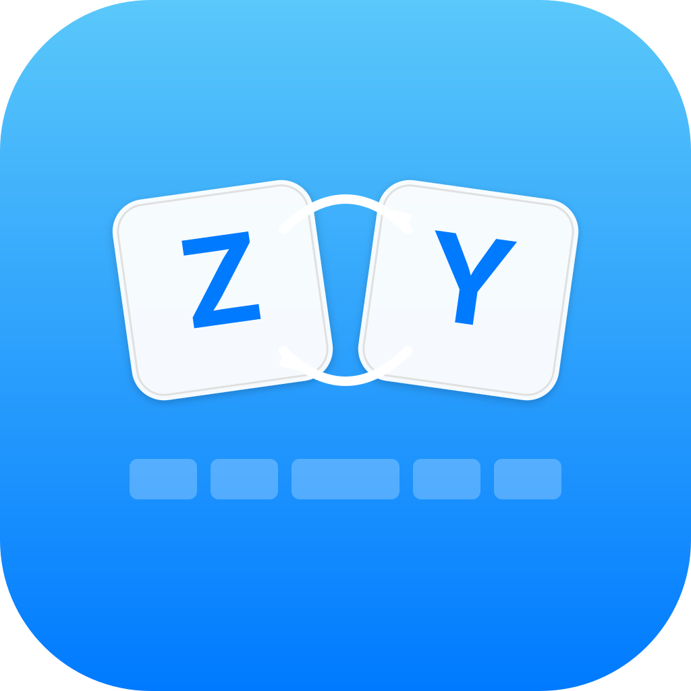

# KezboardSwitcher

<p align="center">
  
</p>

<p align="center">
  <strong>Automatic keyboard layout switching for macOS</strong>
</p>

<p align="center">
  
  
</p>

---

KezboardSwitcher is a lightweight macOS menu bar app that automatically switches your keyboard input layout when you switch between physical keyboards. Perfect for multilingual users who use different layouts on different keyboards (e.g. US on an external keyboard, German on the MacBook).

## How It Works

1. Plug in your keyboards
2. Assign a layout to each keyboard in the configuration window
3. KezboardSwitcher detects which keyboard you're typing on and instantly switches the macOS input source

No more manually toggling layouts every time you switch keyboards.

## Features

- **Automatic layout switching** — detects keyboard changes via IOKit HID and switches input source instantly
- **Menu bar app** — runs silently in the background with no Dock icon
- **Per-keyboard configuration** — assign any enabled macOS input source to each keyboard
- **Ignore list** — mark keyboards you don't want to trigger switches (e.g. YubiKey, Touch Bar)
- **Statistics** — track how often you switch keyboards with daily charts and per-keyboard usage breakdowns
- **Persistent config** — settings saved to `~/.config/KezboardSwitcher/config.json`

## Screenshots

| Configuration | Statistics |
|:---:|:---:|
| Assign layouts to keyboards | Track your switching patterns |

## Installation

### Requirements

- macOS 15.5 or later
- **Input Monitoring** permission (required for keyboard detection)

### Build from Source

```bash
git clone https://github.com/stevio/KezboardSwitcher.git
cd KezboardSwitcher
xcodebuild -project KezboardSwitcher.xcodeproj -scheme KezboardSwitcher -configuration Release build
```

The built app will be in `~/Library/Developer/Xcode/DerivedData/KezboardSwitcher-*/Build/Products/Release/`.

## Usage

- **Left-click** the menu bar icon to open the configuration window
- **Right-click** for the context menu (Open Configuration / Quit)
- The app starts minimized to the menu bar on subsequent launches
- On first launch, the configuration window opens automatically

### Configuring a Keyboard

1. Open the configuration window
2. Select a keyboard from the list on the left
3. Choose a layout from the dropdown on the right
4. Click **Save** to persist your configuration

Keyboards are automatically detected when connected. New keyboards appear with a "New" badge until configured.

### Permissions

KezboardSwitcher requires **Input Monitoring** access to detect which keyboard you're typing on. On first launch, you'll be guided to enable this in System Settings > Privacy & Security > Input Monitoring.

> The app sandbox is disabled because IOKit HID access is not available in sandboxed apps.

## Architecture

```
KezboardSwitcher/
  App/                          # App entry point and delegate
  Features/
    Configuration/              # ConfigService, AppViewModel
      View/                     # ContentView, KeyboardListView, LayoutSelectorView
    CoreLogic/                  # KeyboardManager (IOKit HID), LayoutDetector (TIS API)
    Statistics/                 # StatisticsService (SQLite), StatisticsView
  Shared/                       # Keyboard model, Theme
```

The app uses a straightforward SwiftUI + `@Observable` architecture:

- **KeyboardManager** — listens for HID keyboard events via `IOHIDManager` and detects when you switch keyboards
- **LayoutDetector** — wraps Carbon's Text Input Source (TIS) API to enumerate and switch input layouts
- **ConfigService** — persists keyboard-to-layout mappings as JSON
- **StatisticsService** — records switch events in a local SQLite database
- **AppViewModel** — ties everything together as the single source of truth

## Development

```bash
# Build
xcodebuild -project KezboardSwitcher.xcodeproj -scheme KezboardSwitcher -configuration Debug build

# Run tests
xcodebuild test -project KezboardSwitcher.xcodeproj -scheme KezboardSwitcher -only-testing:KezboardSwitcherTests
```

## License

Copyright (c) 2026 Stefan Viol. All rights reserved.

This is proprietary software. Unauthorized copying, distribution, or modification is strictly prohibited.
